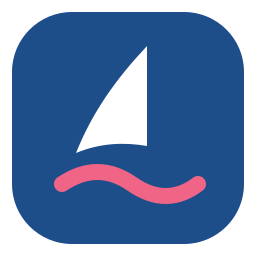
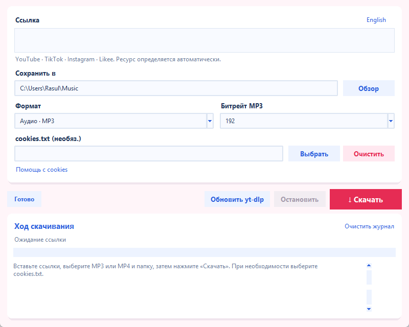
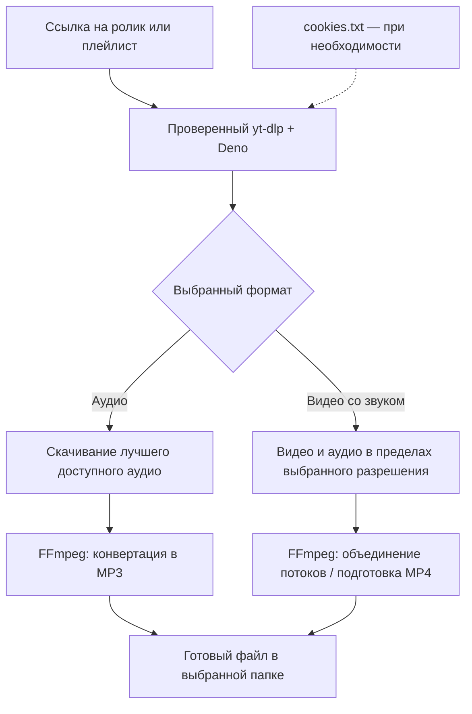
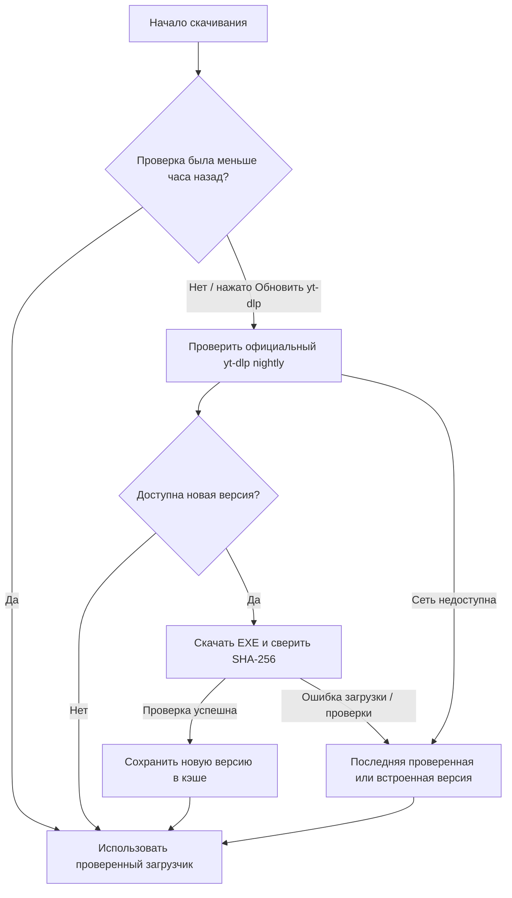

<p align="center">
  
</p>

<h1 align="center">OneCorsair</h1>

<p align="center">Видео и аудио с YouTube — в одном приложении для Windows.</p>

<p align="center">
  <a href="https://github.com/dumuzeyn/OneCorsair/releases/latest/download/OneCorsairSetup.exe">
    
  </a>
</p>

<p align="center">
  <strong>Версия 1.0.2 · Windows x64 · MP3 / MP4</strong><br>
  <a href="https://github.com/dumuzeyn/OneCorsair/releases/latest/download/OneCorsair.exe">Portable EXE</a> ·
  <a href="https://github.com/dumuzeyn/OneCorsair/releases">Все версии</a> ·
  <a href="#english-version">English</a>
</p>

## Русская версия

[English version](#english-version) · [Скачать установщик](https://github.com/dumuzeyn/OneCorsair/releases/latest/download/OneCorsairSetup.exe) · [Portable EXE](https://github.com/dumuzeyn/OneCorsair/releases/latest/download/OneCorsair.exe)

Автономное Windows-приложение для скачивания аудио YouTube в **MP3** и видео со звуком в **MP4**. В EXE включены yt-dlp, FFmpeg, FFprobe и Deno; отдельно устанавливать Python или другие программы не нужно.

В актуальной версии доступны два формата, автоматическое обновление загрузчика, необязательный файл cookies, сохранение настроек и остановка загрузки. Компактное окно открывается по центру экрана. Новый морской логотип имеет 11 сглаженных размеров для значка окна и масштаба Windows.

В **1.0.1** исправлено назначение значка на панели задач: приложение передаёт Windows отдельные значки достаточного разрешения и обновляет их при изменении масштаба монитора.

В **1.0.2** добавлена установка для Windows: приложение появляется в «Установленных приложениях», поиске и списке программ «Пуска». Ярлык использует постоянную иконку и идентификатор `OneCorsair.Downloader`, совпадающий с окном приложения.



### Как скачать

1. Скачайте **OneCorsairSetup.exe** кнопкой выше и установите приложение. Запустите **OneCorsair** из «Пуска». Права администратора не нужны.
2. Вставьте одну или несколько ссылок YouTube. Поддерживаются плейлисты и ссылки, разделённые пробелами или переносами строк.
3. Выберите папку сохранения.
4. Выберите **Аудио · MP3** или **Видео со звуком · MP4**.
5. Для MP3 укажите битрейт 128, 192, 256 или 320 кбит/с. Для видео — максимальное разрешение от 360p до 2160p (4K) или «Лучшее доступное». Если выбранного разрешения нет, используется доступное ниже него.
6. При необходимости выберите экспортированный **cookies.txt**. Поле можно оставить пустым. Кнопка **Помощь с cookies** показывает пошаговую инструкцию, затем открывает YouTube и поиск расширений cookies.txt в Chrome Web Store.
7. Нажмите **Скачать**. Журнал показывает обновление загрузчика, скачивание, обработку и пути готовых файлов.
8. Кнопка **Остановить** прерывает загрузку и запущенные ею процессы FFmpeg/Deno. При закрытии окна приложение также завершает текущую задачу.

### Установка и интеграция с Windows

Установщик размещает программу и иконку в `%LOCALAPPDATA%/Programs/OneCorsair`, создаёт ярлык **OneCorsair** в «Пуске» и регистрирует удаление в **Параметры → Приложения → Установленные приложения**. Приложение устанавливается только для текущего пользователя. Иконка больше не зависит от папки проекта, временных файлов или расположения скачанного установщика.

После установки найдите **OneCorsair** в «Пуске» и при необходимости закрепите его. Если старая закреплённая плитка всё ещё показывает пустой значок, открепите её и закрепите установленный OneCorsair заново. Удаление приложения не удаляет скачанные видео, аудио и сохранённые настройки.

Для запуска без установки доступен **Portable EXE**. Сам по себе переносной файл не добавляет программу в «Установленные приложения».

Для обычного скачивания cookies не обязательны. Если YouTube требует вход или подтверждение, можно выбрать cookies.txt в формате Netscape, экспортированный из браузера с входом в YouTube. Кнопка **Очистить** отключает использование файла. Приложение игнорирует внешние конфигурации и плагины yt-dlp; в интерфейсе читается только выбранный файл. В командной строке также доступен явный параметр `--cookies-from-browser`.

### Как получаются аудио и видео



| Режим | Что сохраняется | Выбор качества |
| --- | --- | --- |
| Аудио · MP3 | Звуковая дорожка в MP3 | 128, 192, 256 или 320 кбит/с |
| Видео со звуком · MP4 | Видео вместе со звуком; отдельные потоки объединяются автоматически | 360p, 480p, 720p, 1080p, 1440p, 2160p или лучшее доступное |

Разрешение — верхняя граница: если выбранное недоступно, загрузчик ищет доступное ниже неё. «Лучшее доступное» снимает эту границу. Повышение битрейта MP3 не улучшает качество исходной записи. Для каждого формата и качества ведётся отдельная история: один ролик можно сохранить и в MP3, и в MP4, а разные варианты получают разные имена файлов.

### Автоматические обновления

Перед скачиванием приложение проверяет официальный канал [yt-dlp nightly](https://github.com/yt-dlp/yt-dlp-nightly-builds/releases). Разработчики yt-dlp [рекомендуют nightly для обычного использования](https://github.com/yt-dlp/yt-dlp#update), поскольку исправления изменений сайтов появляются быстрее, чем в stable.

Проверка выполняется не чаще одного раза в час. **Обновить yt-dlp** принудительно проверяет свежий выпуск. Из GitHub скачивается только новая версия, её SHA-256 сверяется с официальным файлом контрольных сумм. Версии хранятся в `%LOCALAPPDATA%/MP3Ship/yt-dlp`, отдельно от EXE. При недоступности GitHub используется последняя проверенная версия или встроенный загрузчик; причина отображается в журнале.

В официальном yt-dlp.exe уже находятся совместимые EJS-компоненты для обработки JavaScript-подписей YouTube. Они обновляются вместе с загрузчиком; встроенный Deno выполняет их.



### Возможности и ограничения

- Компактный светлый интерфейс без верхней шапки: белые панели, синие заголовки, розовые акценты и красная кнопка скачивания. Окно 800×640 открывается по центру рабочей области экрана; размер можно менять. Лаконичная морская иконка — белый парус и розовая волна на синем фоне.
- Запоминает папку, формат, качество, язык и путь выбранного cookies.txt в `%LOCALAPPDATA%/MP3Ship/settings.json`. Содержимое cookies в настройках не сохраняется.
- Показывает проценты и скорость отдельно от журнала. Журнал ограничен 800 строками, а сообщения обрабатываются порциями, чтобы окно оставалось отзывчивым при долгих загрузках.
- FFmpeg, FFprobe и Deno устанавливаются из встроенного архива в `%LOCALAPPDATA%/MP3Ship/runtime` при первом использовании. Повторный запуск не распаковывает эти большие EXE заново. Файлы проверяются по SHA-256 при установке, а повреждённый кэш восстанавливается из встроенного архива.
- Отдельные ролики, несколько ссылок и плейлисты; русский и английский интерфейс.
- Извлечение и конвертация аудио в MP3.
- Скачивание MP4 со звуком, включая объединение отдельных потоков видео и аудио.
- Ограничение разрешения для всех вариантов выбора видеопотока. При отсутствии подходящего формата приложение сообщает об ошибке.
- Повторные попытки при сетевых сбоях, продолжение частичных загрузок, паузы между файлами для снижения частоты запросов YouTube.
- Отдельная история для формата и качества: например, `.mp3ship_mp3_192_downloaded.txt` и `.mp3ship_mp4_1080_downloaded.txt`. Скачивание MP3 не блокирует скачивание MP4 того же ролика. Имена содержат ID видео и профиль качества, поэтому разные варианты не перезаписывают друг друга.
- Ссылки очищаются после успешного завершения. При ошибке или отмене они сохраняются для повторной попытки.

**Гарантировать скачивание любого видео всегда невозможно.** YouTube может ограничить доступ, потребовать подтверждение входа или заблокировать запросы конкретной сети. Cookies помогают использовать доступ текущего аккаунта; закрытые, платные и некоторые ролики с возрастными ограничениями требуют необходимых прав. Автоматическое обновление исправляет поддерживаемые yt-dlp изменения сайта, но не отменяет эти ограничения.

### Запуск и сборка из исходников

Нужен Python 3.10+ на Windows. Для запуска из исходников установите FFmpeg и FFprobe в PATH; используйте `vendor/deno/deno.exe` либо установите Deno (минимум 2.3.0). Загрузчик yt-dlp скачивается автоматически.

```powershell
python mp3_ship_gui.py
```

Для автономной сборки подготовьте:

```text
C:/ffmpeg/bin/ffmpeg.exe
C:/ffmpeg/bin/ffprobe.exe
vendor/deno/deno.exe
```

```powershell
python -m pip install -r requirements.txt
python prepare_vendor.py
python prepare_runtime.py
python -m PyInstaller --clean --noconfirm OneCorsair.spec
```

`prepare_vendor.py` скачивает и проверяет официальный yt-dlp nightly для включения в EXE. `prepare_runtime.py` собирает архив FFmpeg/FFprobe/Deno; пути этих инструментов можно изменить в этом скрипте. Готовое приложение: `dist/OneCorsair.exe`. Чтобы заново экспортировать SVG/PNG/ICO иконки, выполните `python create_icon.py`.

Установщик собирается [Inno Setup 7](https://jrsoftware.org/isinfo.php). После сборки EXE выполните команду компилятором `ISCC.exe`:

```powershell
ISCC.exe OneCorsair.iss
```

Результат: `dist/OneCorsairSetup.exe`. Установщик опубликован в релизах; исходник установки — `OneCorsair.iss`.

### Командная строка

```powershell
# Аудио MP3
python youtube_to_mp3.py "C:/Users/User/Music" "https://www.youtube.com/watch?v=VIDEO_ID" --quality 320

# Видео MP4 со звуком, максимум 1080p
python youtube_to_mp3.py "C:/Users/User/Videos" "https://www.youtube.com/watch?v=VIDEO_ID" --mode video --height 1080

# Лучшее доступное разрешение и принудительная проверка обновлений
python youtube_to_mp3.py "C:/Users/User/Videos" "https://www.youtube.com/watch?v=VIDEO_ID" --mode video --height best --update

# С выбранным cookies.txt
python youtube_to_mp3.py "C:/Users/User/Videos" "https://www.youtube.com/watch?v=VIDEO_ID" --mode video --cookies "C:/Users/User/Downloads/cookies.txt"
```

### Проверки

```powershell
python -m unittest discover -s tests -v

# Дополнительно: настоящие yt-dlp/FFmpeg, локальный HTTP-сервер и тестовые медиа
$env:MP3SHIP_INTEGRATION = '1'
python -m unittest discover -s tests -p test_media_integration.py -v
```

## English version

[Русская версия](#русская-версия) · [Windows installer](https://github.com/dumuzeyn/OneCorsair/releases/latest/download/OneCorsairSetup.exe) · [Portable EXE](https://github.com/dumuzeyn/OneCorsair/releases/latest/download/OneCorsair.exe)

OneCorsair is a self-contained Windows application for downloading YouTube audio as **MP3** or video with sound as **MP4**. The EXE bundles yt-dlp, FFmpeg, FFprobe and Deno.

Version 1.0.2 adds a per-user Windows installer. The app appears in Installed apps and the Start menu, with an uninstaller, a stable icon path and a shortcut AppUserModelID matching its window. Installation uses `%LOCALAPPDATA%/Programs/OneCorsair` and does not require administrator privileges. The main download button downloads **OneCorsairSetup.exe**; **OneCorsair.exe** remains available for portable use. Old pinned entries may need to be unpinned and the installed app pinned again.

The app includes automatic engine updates, optional cookies, saved preferences, cancellation, a compact centered window and a nautical logo with 11 smooth icon sizes. Native taskbar icons use sufficient resolution and follow monitor scale changes.

The compact light interface has no large header and uses white panels, blue headings, pink accents and a red Download button. The minimal nautical icon combines a white sail and a pink wave on a blue background. The resizable 800×640 window opens in the center of the desktop work area. Folder, format, quality, language and cookies file path are remembered. Progress samples are coalesced and the activity log is capped at 800 lines. Large tools are installed once into the app cache, instead of unpacking those executables on every startup. Cookies help shows export instructions, then opens YouTube and the cookies.txt search in the Chrome Web Store.

Paste video or playlist links, choose an output folder, select audio or video, choose a bitrate or maximum resolution, then press **Download**. MP3 supports 128–320 kbps. Video supports maximum heights of 360p–2160p (4K) and **Best available**. **Stop** also terminates the downloader's child processes.

You can select an exported Netscape **cookies.txt** file when YouTube requires sign-in or confirmation. Leave the field empty or press **Clear** to download without cookies. The CLI also supports explicit `--cookies-from-browser`. The app ignores external yt-dlp configuration and plugins. Before downloading it checks the official nightly release, at most once per hour; **Update yt-dlp** forces a fresh check. Downloads are checked against the official SHA-256 manifest. The last verified version or bundled engine remains available if GitHub cannot be reached. Updated engines are stored in `%LOCALAPPDATA%/MP3Ship/yt-dlp`.

Separate archives and filenames for each format and quality allow both MP3 and MP4 of the same video. A failed conversion is reported as a failure. Links are cleared only after success.

Anonymous downloading cannot be guaranteed for every video: YouTube may require sign-in or restrict a network, and private, paid or age-restricted content may be unavailable. Updating yt-dlp cannot remove those access restrictions.

To build, install `requirements.txt`, provide FFmpeg/FFprobe and Deno at the paths shown above, run `python prepare_vendor.py` and `python prepare_runtime.py`, then `python -m PyInstaller --clean --noconfirm OneCorsair.spec`. For the CLI, use `--mode audio --quality 320` or `--mode video --height 1080`; `--height best` selects the best available video. `--update` forces an update check.

## Author

Zeynalov U.R.o.
