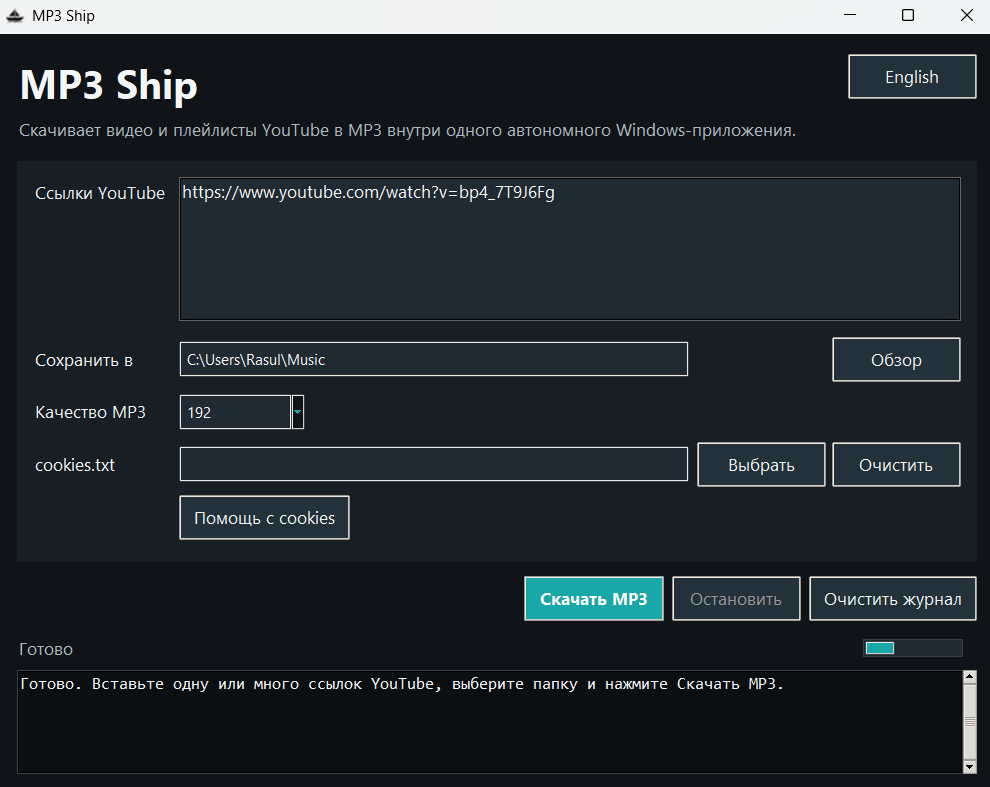
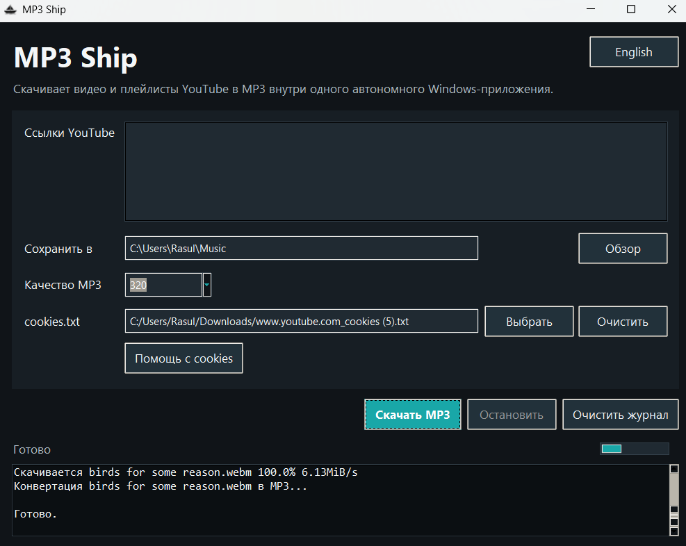
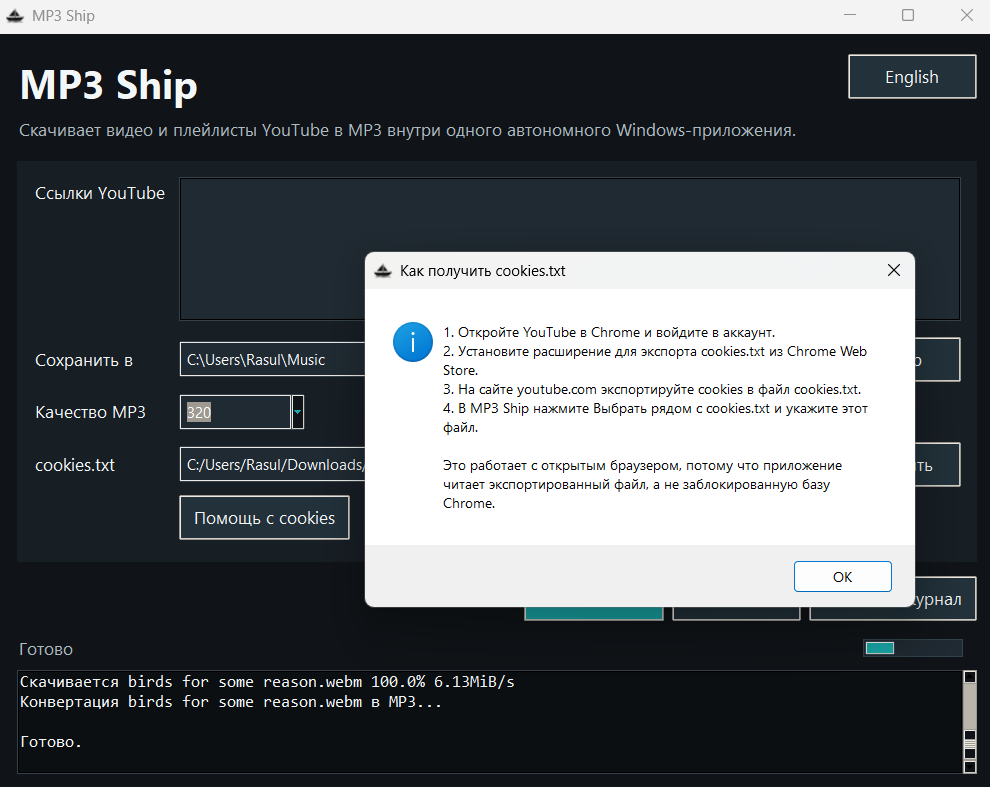

# MP3 Ship

## Русская Версия

[English version](#english-version)

### [Скачать MP3Ship.exe](dist/MP3Ship.exe)

MP3 Ship - автономное Windows-приложение для скачивания аудио с YouTube в MP3. Пользователь скачивает один `.exe` файл и запускает его без установки Python, FFmpeg, Deno, Node или дополнительных библиотек.



### Как Работает Для Пользователя

1. Откройте `MP3Ship.exe`.
2. Вставьте одну или несколько ссылок YouTube в поле `Ссылки YouTube`.
3. Выберите папку, куда сохранить готовые MP3-файлы.
4. Выберите качество MP3: `128`, `192`, `256` или `320`.
5. Если YouTube просит подтвердить, что вы не бот, выберите экспортированный `cookies.txt`.
6. Нажмите `Скачать MP3`.
7. Следите за процессом в журнале внизу окна.
8. Если нужно прервать процесс, нажмите `Остановить`.



### Что Умеет Приложение

- Скачивает одно видео, несколько ссылок или целый плейлист YouTube.
- Принимает много ссылок сразу: по строкам, через пробел или списком из сообщения.
- Сохраняет результат в выбранную пользователем папку.
- Конвертирует скачанное аудио в `.mp3`.
- Позволяет выбрать качество MP3.
- Показывает журнал скачивания и конвертации.
- Позволяет остановить текущее скачивание.
- Поддерживает русский и английский интерфейс.
- Запоминает уже скачанные видео в `.mp3ship_downloaded.txt` внутри выбранной папки и не скачивает их повторно, даже если MP3 потом удалить.
- Очищает поле ссылок после успешного скачивания, чтобы старые ссылки случайно не запускались снова.
- Использует `cookies.txt`, когда YouTube требует вход или проверку “not a bot”.
- Содержит внутри FFmpeg для конвертации и Deno для решения YouTube JavaScript-подписей.

### Как Работает Внутри

Приложение использует `yt-dlp` для получения аудио с YouTube. После скачивания встроенный FFmpeg конвертирует файл в MP3. Для новых YouTube-проверок подписи внутри exe также лежит Deno, поэтому пользователю не нужно отдельно устанавливать JavaScript runtime.

Если YouTube требует авторизацию или проверку, приложение может использовать файл `cookies.txt`. Кнопка `Помощь с cookies` показывает понятную инструкцию: пользователь входит в YouTube в браузере, экспортирует cookies в файл и выбирает этот файл в MP3 Ship. Это работает даже с открытым браузером, потому что приложение читает обычный экспортированный файл, а не заблокированную базу Chrome или Edge.



### Сборка Из Исходников

```powershell
python -m pip install -r requirements.txt
python -m PyInstaller --clean --noconfirm MP3Ship.spec
```

Для сборки должны существовать:

```text
C:\ffmpeg\bin\ffmpeg.exe
vendor\deno\deno.exe
```

Готовый файл появится здесь:

```text
dist\MP3Ship.exe
```

### Командная Строка

```powershell
python youtube_to_mp3.py "C:\Users\User\Music" "https://www.youtube.com/watch?v=VIDEO_ID" --quality 320
```

С cookies:

```powershell
python youtube_to_mp3.py "C:\Users\User\Music" "https://www.youtube.com/watch?v=VIDEO_ID" --cookies "C:\Users\User\Downloads\cookies.txt"
```

Используйте приложение только для своих видео, видео со свободной лицензией или контента, который вы имеете право скачивать.

---

## English Version

[Русская версия](#русская-версия)

### [Download MP3Ship.exe](dist/MP3Ship.exe)

MP3 Ship is a self-contained Windows app for downloading YouTube audio as MP3. The user downloads one `.exe` file and runs it without installing Python, FFmpeg, Deno, Node, or extra libraries.


### How It Works For The User

1. Open `MP3Ship.exe`.
2. Paste one or more YouTube links into the `YouTube links` field.
3. Choose the folder where the finished MP3 files should be saved.
4. Choose MP3 quality: `128`, `192`, `256`, or `320`.
5. If YouTube asks to confirm that you are not a bot, choose an exported `cookies.txt` file.
6. Press `Download MP3`.
7. Watch download and conversion progress in the log at the bottom.
8. Press `Stop` if you need to interrupt the current download.


### What The App Can Do

- Downloads one video, several links, or a full YouTube playlist.
- Accepts many links at once: line by line, separated by spaces, or pasted from a message.
- Saves output into the folder selected by the user.
- Converts downloaded audio to `.mp3`.
- Lets the user choose MP3 quality.
- Shows a download and conversion log.
- Stops the current download on request.
- Supports Russian and English UI.
- Remembers already downloaded videos in `.mp3ship_downloaded.txt` inside the chosen folder and does not download them again, even if the MP3 file is deleted later.
- Clears the links field after a successful download so old links are not accidentally started again.
- Uses `cookies.txt` when YouTube requires sign-in or a “not a bot” check.
- Bundles FFmpeg for conversion and Deno for YouTube JavaScript signature solving.

### How It Works Internally

The app uses `yt-dlp` to fetch audio from YouTube. After downloading, bundled FFmpeg converts the file to MP3. For modern YouTube signature checks, bundled Deno is included inside the exe, so the user does not need to install a JavaScript runtime separately.

When YouTube requires sign-in or bot confirmation, the app can use a `cookies.txt` file. The `Cookies help` button shows a simple flow: sign in to YouTube in the browser, export cookies to a file, and select that file in MP3 Ship. This works even while the browser is open because the app reads the exported file instead of Chrome or Edge's locked cookie database.


### Build From Source

```powershell
python -m pip install -r requirements.txt
python -m PyInstaller --clean --noconfirm MP3Ship.spec
```

These files must exist before building:

```text
C:\ffmpeg\bin\ffmpeg.exe
vendor\deno\deno.exe
```

The built file will be created here:

```text
dist\MP3Ship.exe
```

### Command Line

```powershell
python youtube_to_mp3.py "C:\Users\User\Music" "https://www.youtube.com/watch?v=VIDEO_ID" --quality 320
```

With cookies:

```powershell
python youtube_to_mp3.py "C:\Users\User\Music" "https://www.youtube.com/watch?v=VIDEO_ID" --cookies "C:\Users\User\Downloads\cookies.txt"
```

Use the app only for your own videos, freely licensed videos, or content that you have the right to download.

## Author

Zeynalov U.R.o.
